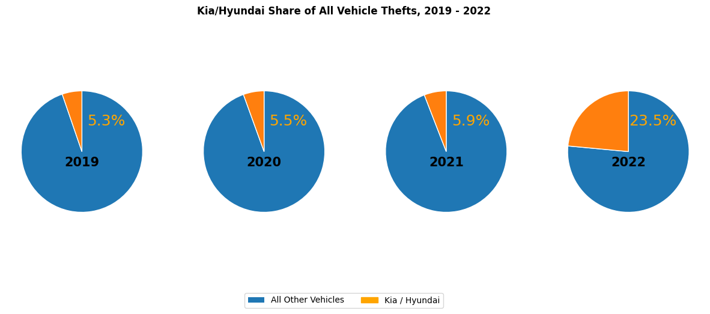
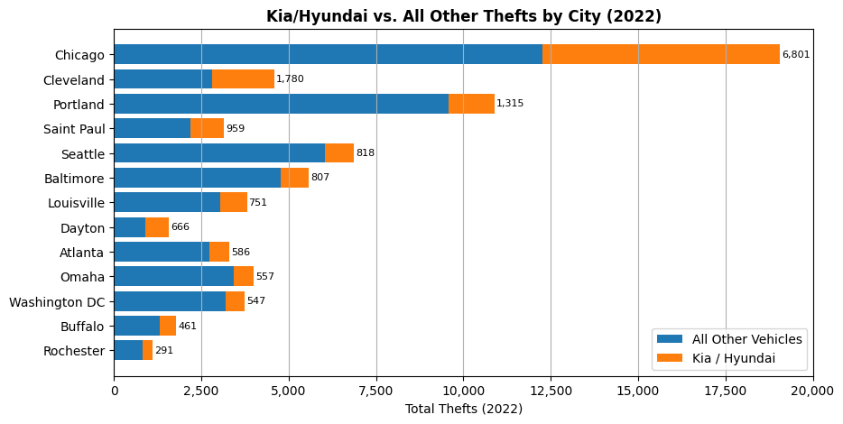
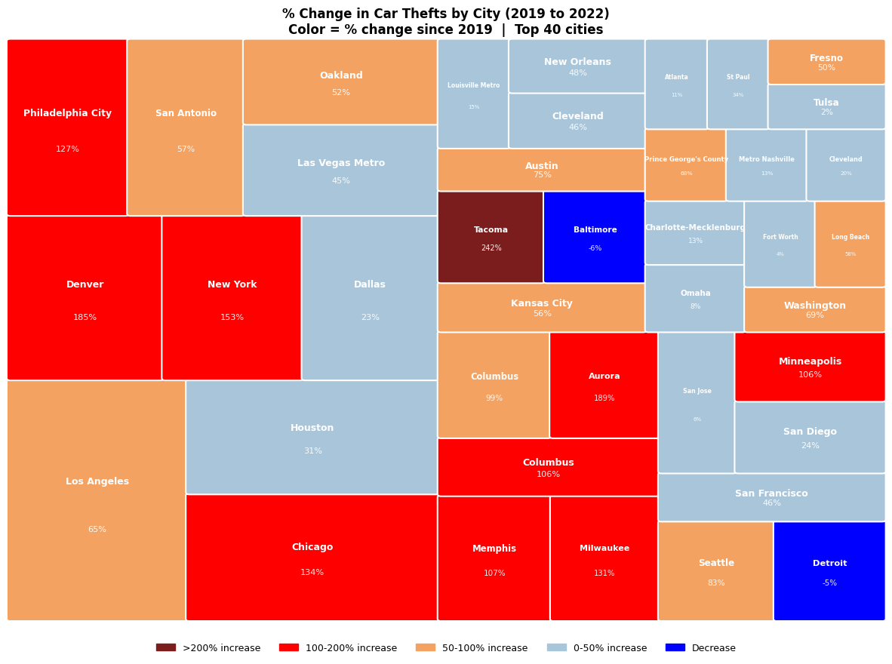

# The TikTok Car Theft Epidemic: A Data Story

**How did a design flaw in Kias and Hyundais become a nationwide crime wave?** Many 2011–2021 Kia and Hyundai models were sold without engine immobilizers, making them far easier to steal. This project uses four datasets and six visualizations to tell the story of how thefts exploded, first in Milwaukee and then across the country, and ends with a call to action for affected owners.

📓 [Notebook](tiktok_car_thefts.ipynb) · 📄 [Paper](tiktok_car_thefts_writeup.pdf)

---

## The Story in Four Findings

**1. Thefts grew nearly ninefold in three years.** Across the 13 cities tracked, Kia/Hyundai thefts rose from 1,866 in 2019 to 16,339 in 2022, and their share of all car thefts jumped from about 5% to 23.5%. Almost all of that jump happened in 2022.

**2. Milwaukee was ground zero, more than a year before TikTok.** Kias and Hyundais made up under 10% of Milwaukee's car thefts until late 2020, then surged to a peak of 71.4% in April 2021. The theft method only spread nationally after it went viral on TikTok in summer 2022.

**3. Then it went national.** Monthly Kia/Hyundai thefts across the tracked cities stayed small through mid-2022, then climbed steeply in the second half of the year.

**4. Some cities were hit far harder than others.** Chicago alone accounted for 6,801 Kia/Hyundai thefts in 2022, about 42% of the 13-city total. Among the 556 law enforcement agencies in the national dataset, more than 100 saw overall car thefts at least double from 2019 to 2022.

## Call to Action

If you own a 2011–2021 Kia or Hyundai, check whether your vehicle qualifies for the manufacturer's anti-theft software update or steering-wheel lock, and support efforts to hold manufacturers responsible for fully funding the fix.

## Storytelling Design

- **Audience:** Adults 18–45 who own cars, use social media, or both, plus consumer advocates, policymakers, and journalists who can amplify the message.
- **Purpose:** To inform and advocate, making the scale and spread of the problem impossible to ignore.
- **Medium:** An investigative data-journalism presentation that moves from the national picture down to Milwaukee's extreme case.
- **Design choices:** A consistent two-color palette (orange for Kia/Hyundai, blue for everything else) across all charts. Each chart type was matched to its insight: pies and a donut for share, area charts for change over time, stacked bars for city comparisons, and a treemap to show both the size and severity of increases across 40 cities.

*Box size shows 2022 theft volume; color shows the percent change in car thefts since 2019.*

## Data

| Dataset | Description |
|---------|-------------|
| `kiaHyundaiThefts.csv` | Monthly Kia/Hyundai vs. other thefts for 13 cities, 2019–2022 |
| `KiaHyundaiMilwaukeeData.csv` | The same monthly breakdown for Milwaukee |
| `carTheftsMap.csv` | Total car thefts for 556 agencies with percent change from 2019 to 2022 |
| Motherboard / VICE News theft data | Kia/Hyundai and total thefts for dozens of cities, reshaped from wide to long format |

The datasets were compiled by VICE/Motherboard from police department records.

## Ethical Considerations

The data comes from a news organization rather than a government agency, so city coverage may be uneven. The popular "Kia Boys" framing has carried racialized undertones, so this story deliberately places responsibility on the manufacturers' design decision rather than on communities or individuals. Charts were designed to show an institutional failure, not to stigmatize cities, and the call to action points toward legal and regulatory remedies.

## Tools

Python · pandas · NumPy · matplotlib (including a custom treemap layout written from scratch) · Jupyter

---

*Completed April 2026 for DSC 640 (Data Presentation and Visualization).*
